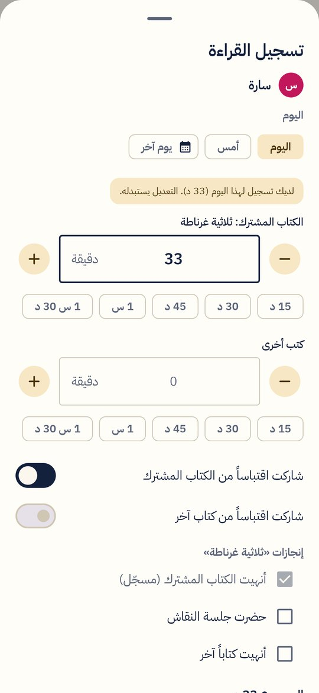
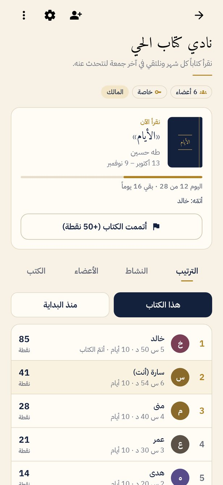
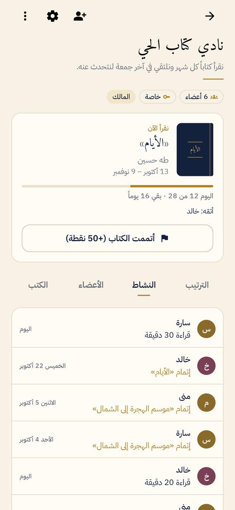
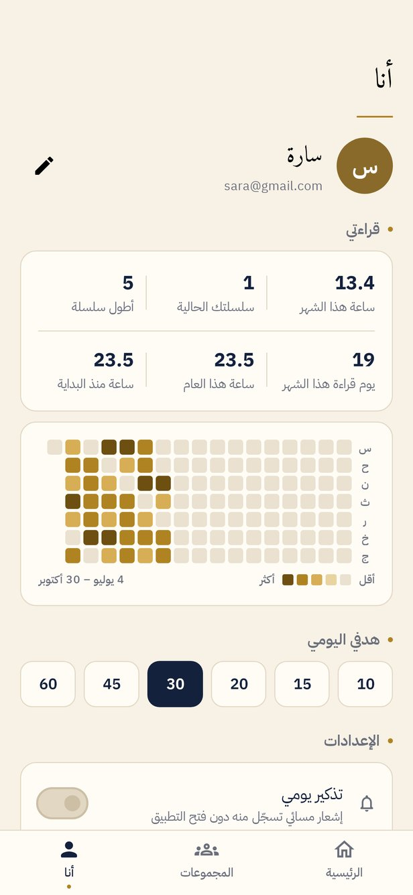

<div dir="rtl">

# ماراثون القراءة

تطبيق أندرويد للقراءة اليومية: تختار الكتاب الذي تقرؤه، وتسجّل وقتك فيه بلمسة واحدة. وحدك على رفّك، أو مع أصدقائك في مجموعات تتسابق على كتاب مشترك.

**التحميل:** https://ahmad-nayfeh.github.io/marathon/

<p>






</p>

## ماذا يفعل

- **الكتاب أولاً:** كل دقيقة تُسجَّل في كتاب. في الرئيسية بطاقة لكل كتاب تقرؤه، فيها أزرار 15 و30 و45 و60 دقيقة (مع تراجع)، ومؤقت يعمل في الإشعار وأنت تقرأ، و«وقت آخر» لأي يوم من آخر أسبوعين. وتذكير المساء يسجّل في كتابك مباشرة دون فتح التطبيق.
- **رفّي:** كتبك أنت، بمجموعة أو بدونها: أقرأ الآن، أتممتها، أريد قراءتها. لكل كتاب وقتك فيه وأيام قراءته وتاريخ إتمامه.
- **القراءة شخصية، والمجموعات تجمعها:** تسجّل مرة واحدة، وتُحسب في كل مجموعة تنضم إليها. كتاب المجموعة الحالي يُضاف إلى رفّك تلقائياً، و«أتممته» على الرفّ يُسجَّل في المجموعة أيضاً.
- **المجموعات:** أنشئ مجموعة لأصدقائك أو عائلتك أو نادي القراءة، وادعُ برمز من 6 أحرف أو برابط. المجموعة خاصة (بالرمز فقط) أو عامة يجدها أي قارئ.
- **الكتاب المشترك:** لكل فترة كتاب ومدة، مع الترتيب ونسبة التقدم ومن أتمّ الكتاب.
- **فهرس كتب موحّد:** المشرف يختار الكتاب من الفهرس فيأتي المؤلف معه، والكتاب الواحد بأسمائه المختلفة مُدخَل واحد. إن لم يجده أضافه (يُستخدم فوراً ويُراجَع)، ويستطيع أي قارئ اقتراح تصحيح العنوان أو المؤلف أو الإبلاغ عن كتاب مكرر.
- **النقاط:** نقطة لكل عدد من الدقائق تختاره المجموعة (10 افتراضياً)، ومكافأة لإتمام الكتاب (50 افتراضياً). والمجموعة تختار ما يُحسب: كل قراءة الأعضاء (ويظهر وقت الكتاب المشترك بجانبها) أو الكتاب المشترك وحده. الترتيب للكتاب الحالي أو منذ البداية، ومشاركته نصاً في واتساب.
- **النشاط:** من قرأ اليوم وكم، ومن أتمّ الكتاب.
- **صفحتي:** هدف يومي شخصي، أيام متتالية، ساعات الشهر والعام، وخريطة القراءة.
- **للمشرفين:** الكتب، الأعضاء والأدوار (مالك، مشرف، عضو)، قرّاء دون تطبيق يُسجَّل عنهم، دمج تاريخهم في حساباتهم لاحقاً، استيراد ردود نموذج Google القديم، وتصدير CSV.
- **فاتح وداكن**، والواجهة عربية من اليمين إلى اليسار دائماً.

## الحسابات والبيانات

- **الدخول:** بحساب Google، أو دون حساب. يمكن ربط حساب Google لاحقاً من صفحة «أنا» دون خسارة شيء.
- **البيانات:** في Firestore. سجلّ القراءة الشخصي والرفّ لا يقرؤهما غير صاحبهما؛ والمجموعة يقرأ بياناتها أعضاؤها فقط. التسجيل يعمل دون اتصال ويُرسل عند عودته.
- **لوحة إدارة المنصة:** لحساب الإدارة فقط، بنفس القوة داخل التطبيق وعلى الويب (`/marathon/admin/`): مراجعة الاقتراحات، فهرس الكتب (تعديل، دمج المكرر، حذف، استيراد قائمة)، إدارة أي مجموعة (الإعدادات، الأدوار ونقل الملكية، إخراج الأعضاء، الحذف)، المستخدمون (تغيير الاسم، الإيقاف، حذف البيانات)، الإعلانات، الإحصاءات، وسجل بكل عملية. الصلاحيات مفروضة في قواعد الأمان نفسها، لا في التطبيق فقط.
- **قائمة كتب أولية:** `docs/books-starter.csv` (نحو 50 كتاباً معروفاً) يمكن استيرادها من لوحة الإدارة ← الكتب ← استيراد قائمة.

## التثبيت

نزّل ملف APK من [صفحة التطبيق](https://ahmad-nayfeh.github.io/marathon/) أو من [الإصدارات](../../releases)، افتحه على الهاتف، واسمح بالتثبيت من هذا المصدر إن طُلب منك.

## للمطوّر

```
app/    واجهة Jetpack Compose، الحسابات، Firestore، الإشعارات والمؤقت
core/   منطق نقي بلغة Kotlin: النقاط، الترتيب، الإحصاءات، التحقق، استيراد CSV (مع اختبارات)
firestore.rules         قواعد الأمان
firestore-tests/        اختبارات القواعد على محاكي Firestore
```

- البناء: `./gradlew :app:assembleDebug` (JDK 17).
- الاختبارات: `./gradlew :core:test`، و`./gradlew :app:recordRoborazziDebug` (يشغّل الواجهة الحقيقية على خادم وهمي في الذاكرة ويلتقط صورة لكل شاشة في `app/build/shots`)، و`cd firestore-tests && npm install && npm test` (قواعد الأمان على المحاكي).
- مواصفات السلوك: [SPEC.md](SPEC.md).

### إعداد Firebase

1. أنشئ مشروع Firebase، وأضف تطبيق أندرويد بالمعرّف `com.readingmarathon.app` مع بصمة SHA-1 لمفتاح التوقيع.
2. فعّل **Authentication ← Google** و**Anonymous**، وأنشئ **Firestore** في وضع الإنتاج.
3. انشر القواعد: `firebase deploy --only firestore:rules`، أو الصقها في Firestore ← Rules.
4. ضع `google-services.json` في سرّ المستودع `MARATHON_GOOGLE_SERVICES_BASE64` بترميز base64 (لا يُرفع الملف نفسه).

### توقيع الإصدارات

أسرار المستودع: `MARATHON_KEYSTORE_BASE64`، `MARATHON_KEYSTORE_PASSWORD`، `MARATHON_KEY_ALIAS`، `MARATHON_KEY_PASSWORD`. بعدها ينشر وسم مثل `v0.1.0` إصداراً موقّعاً تلقائياً. احتفظ بملف المفتاح في مكان آمن: بدونه لا يمكن تحديث التطبيق المثبّت.

</div>
