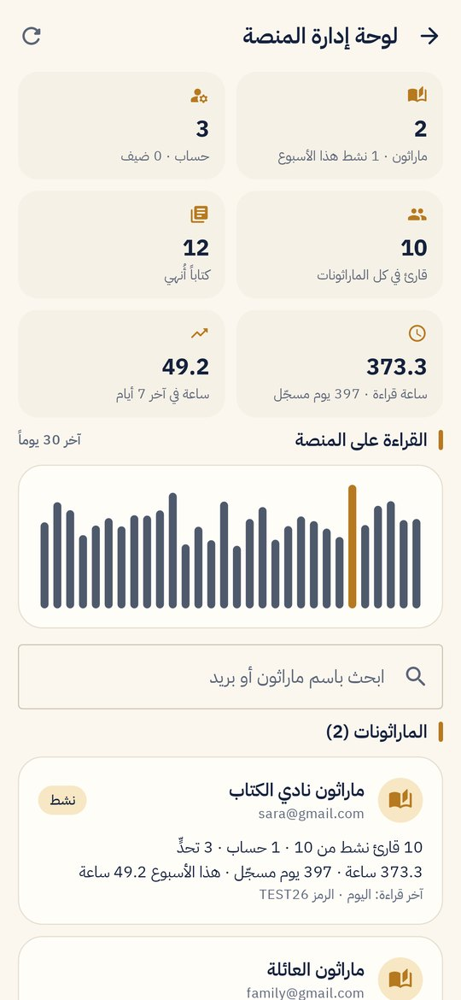

<div dir="rtl">

# ماراثون القراءة

تطبيق أندرويد لمجموعات القراءة: كتاب مشترك لكل تحدٍّ، تسجيل يومي لدقائق القراءة، نقاط وترتيب، أوسمة، لوحة شرف، وتقارير PDF.

**التحميل:** https://ahmad-nayfeh.github.io/marathon/

<p>



</p>

## ماذا يفعل

- **التحديات:** لكل تحدٍّ كتاب مشترك ومدة محددة ونظام نقاط خاص به. التحديات لا تتداخل في التواريخ.
- **التسجيل اليومي:** دقائق الكتاب المشترك ودقائق الكتب الأخرى والاقتباسات، مع إنجازات إنهاء الكتاب وحضور النقاش. تسجيل واحد لكل قارئ في اليوم؛ التسجيل مرة أخرى يعدّله.
- **النقاط والترتيب:** للتحدي الحالي أو لكل الماراثون، مع منصة التتويج ولوحة الشرف.
- **الأوسمة:** الفيلسوف، العدّاء، المثابرة، الملتهم، المحاور.
- **التحليلات:** الساعات المتراكمة، ساعات كل قارئ، أيام الأسبوع، الكتاب المشترك مقابل غيره، وخريطة القراءة.
- **التقارير والبيانات:** تقرير PDF للتحدي أو للماراثون كله، تصدير CSV لبرنامج Excel، نسخة احتياطية JSON، واستيراد ردود نموذج Google القديم.
- **تذكير يومي** محلي على الهاتف.
- **فاتح وداكن**، والواجهة عربية من اليمين إلى اليسار دائماً.

## الحسابات والبيانات

- **الدخول:** بحساب Google، أو كضيف بلا حساب. يستطيع الضيف ربط حساب Google لاحقاً من الإعدادات دون أن يخسر شيئاً.
- **البيانات:** كل ماراثون محفوظ في Firestore، فيسجّل كل قارئ من هاتفه وتظهر النتائج للجميع لحظة بلحظة، ويعمل التسجيل دون اتصال ثم يُرسل عند عودته.
- **الانضمام:** المشرف ينشئ الماراثون ويشارك رمز دعوة من 6 أحرف أو رابطاً يفتح التطبيق مباشرة.
- **لوحة إدارة المنصة:** لحساب الإدارة فقط، داخل التطبيق وعلى الويب (`/marathon/admin/`). تعرض كل الماراثونات والحسابات والنشاط. الصلاحية مفروضة في قواعد الأمان نفسها، لا في التطبيق فقط.

## التثبيت

نزّل ملف APK من [صفحة التطبيق](https://ahmad-nayfeh.github.io/marathon/) أو من [الإصدارات](../../releases)، افتحه على الهاتف، واسمح بالتثبيت من هذا المصدر إن طُلب منك.

## للمطوّر

```
app/    واجهة Jetpack Compose، الحسابات (Google أو ضيف)، Firestore، لوحة الإدارة، التقارير، التذكير
core/   منطق نقي بلغة Kotlin: النقاط، الأوسمة، التحليلات، التحقق، استيراد CSV (مع اختبارات)
firestore.rules         قواعد الأمان للوضع المشترك
firestore-tests/        اختبارات القواعد على محاكي Firestore
```

- البناء: `./gradlew :app:assembleDebug` (JDK 17).
- الاختبارات: `./gradlew :core:test` و`./gradlew :app:recordRoborazziDebug` (يشغّل الواجهة الحقيقية على خادم وهمي في الذاكرة ويلتقط صورة لكل شاشة في `app/build/shots`) و`cd firestore-tests && npm install && npm test` (قواعد الأمان على المحاكي).
- مواصفات السلوك: [SPEC.md](SPEC.md).

### إعداد Firebase

1. أنشئ مشروع Firebase، وأضف تطبيق أندرويد بالمعرّف `com.readingmarathon.app` مع بصمة SHA-1 لمفتاح التوقيع.
2. فعّل **Authentication ← Google** و**Anonymous**، وأنشئ **Firestore** في وضع الإنتاج.
3. انشر القواعد: `firebase deploy --only firestore:rules`.
4. حمّل `google-services.json` وضعه في سرّ المستودع `MARATHON_GOOGLE_SERVICES_BASE64` بترميز base64 (لا يُرفع الملف نفسه إلى المستودع). بدونه تُبنى النسخة لكنها لا تستطيع تسجيل الدخول.

### توقيع الإصدارات

أسرار المستودع: `MARATHON_KEYSTORE_BASE64`، `MARATHON_KEYSTORE_PASSWORD`، `MARATHON_KEY_ALIAS`، `MARATHON_KEY_PASSWORD`. بعدها ينشر وسم مثل `v1.0.0` إصداراً موقّعاً تلقائياً. احتفظ بملف المفتاح في مكان آمن: بدونه لا يمكن تحديث التطبيق المثبّت.

</div>
