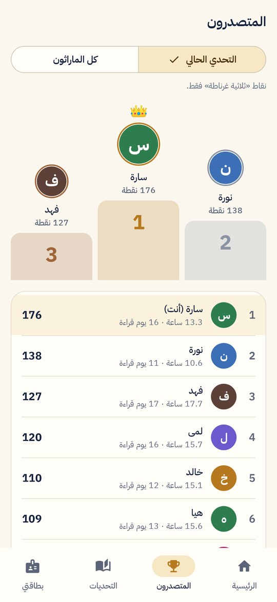
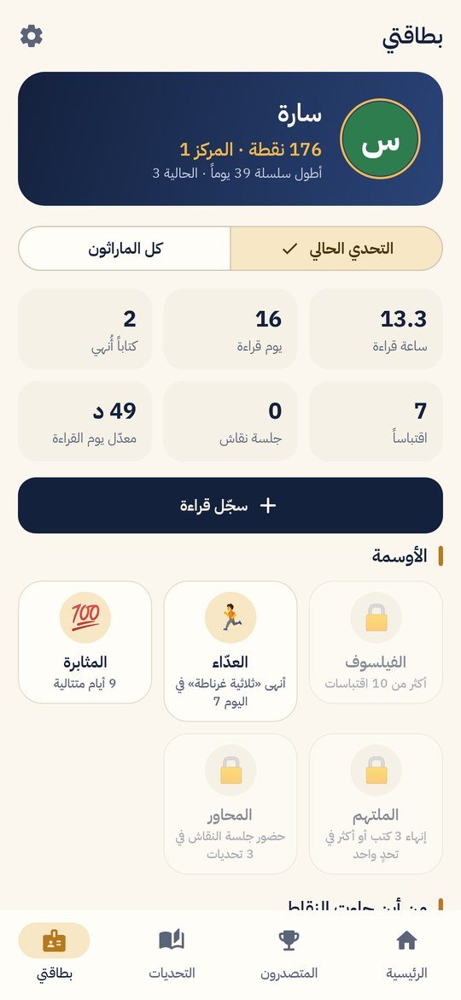

<div dir="rtl">

# ماراثون القراءة

تطبيق أندرويد لمجموعات القراءة: كتاب مشترك لكل تحدٍّ، تسجيل يومي لدقائق القراءة، نقاط وترتيب، أوسمة، لوحة شرف، وتقارير PDF.

**التحميل:** https://ahmad-nayfeh.github.io/marathon/

<p>




</p>

## ماذا يفعل

- **التحديات:** لكل تحدٍّ كتاب مشترك ومدة محددة ونظام نقاط خاص به. التحديات لا تتداخل في التواريخ.
- **التسجيل اليومي:** دقائق الكتاب المشترك ودقائق الكتب الأخرى والاقتباسات، مع إنجازات إنهاء الكتاب وحضور النقاش. تسجيل واحد لكل قارئ في اليوم؛ التسجيل مرة أخرى يعدّله.
- **النقاط والترتيب:** للتحدي الحالي أو لكل الماراثون، مع منصة التتويج ولوحة الشرف.
- **الأوسمة:** الفيلسوف، العدّاء، المثابرة، الملتهم، المحاور.
- **التحليلات:** الساعات المتراكمة، ساعات كل قارئ، أيام الأسبوع، الكتاب المشترك مقابل غيره، وخريطة القراءة.
- **التقارير والبيانات:** تقرير PDF للتحدي أو للماراثون كله، تصدير CSV لبرنامج Excel، نسخة احتياطية JSON واستعادتها، واستيراد ردود نموذج Google القديم.
- **تذكير يومي** محلي على الهاتف.
- **فاتح وداكن**، والواجهة عربية من اليمين إلى اليسار دائماً.

## ثلاثة أوضاع

| الوضع | لمن | يحتاج إنترنت؟ |
|---|---|---|
| على هذا الجهاز | المشرف يسجّل للمجموعة من هاتفه | لا |
| مشترك | كل قارئ يسجّل من هاتفه برمز دعوة | نعم (Firebase) |
| تجريبي | لاستكشاف التطبيق ببيانات وهمية | لا |

الوضع المشترك يظهر فقط في النسخ المبنية بإعدادات Firebase حقيقية (انظر الأسفل). بدونها يعمل التطبيق كاملاً على الجهاز.

## التثبيت

نزّل ملف APK من [صفحة التطبيق](https://ahmad-nayfeh.github.io/marathon/) أو من [الإصدارات](../../releases)، افتحه على الهاتف، واسمح بالتثبيت من هذا المصدر إن طُلب منك.

## للمطوّر

```
app/    واجهة Jetpack Compose، التخزين المحلي (JSON) وFirestore، التقارير، التذكير
core/   منطق نقي بلغة Kotlin: النقاط، الأوسمة، التحليلات، التحقق، استيراد CSV (مع اختبارات)
firestore.rules         قواعد الأمان للوضع المشترك
firestore-tests/        اختبارات القواعد على محاكي Firestore
```

- البناء: `./gradlew :app:assembleDebug` (JDK 17).
- الاختبارات: `./gradlew :core:test` و`./gradlew :app:recordRoborazziDebug` (جولة صور لكل الشاشات في `app/build/shots`) و`cd firestore-tests && npm install && npm test`.
- مواصفات السلوك: [SPEC.md](SPEC.md).

### تفعيل الوضع المشترك (Firebase)

1. أنشئ مشروع Firebase، وأضف تطبيق أندرويد بالمعرّف `com.readingmarathon.app`.
2. فعّل **Authentication ← Anonymous**، وأنشئ **Firestore** في وضع الإنتاج.
3. انشر القواعد: `firebase deploy --only firestore:rules`.
4. حمّل `google-services.json` وضعه في سرّ المستودع `MARATHON_GOOGLE_SERVICES_BASE64` بترميز base64 (لا يُرفع الملف نفسه إلى المستودع).

### توقيع الإصدارات

أسرار المستودع: `MARATHON_KEYSTORE_BASE64`، `MARATHON_KEYSTORE_PASSWORD`، `MARATHON_KEY_ALIAS`، `MARATHON_KEY_PASSWORD`. بعدها ينشر وسم مثل `v1.0.0` إصداراً موقّعاً تلقائياً. احتفظ بملف المفتاح في مكان آمن: بدونه لا يمكن تحديث التطبيق المثبّت.

</div>
